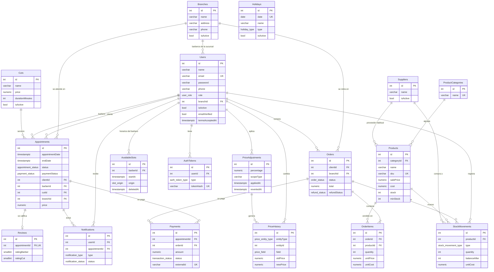

# Base de datos

PostgreSQL (Supabase). El esquema se define con migraciones de EF Core (`src/CraneoBarbero.Api/Data/Migrations`). Las tablas van en PascalCase y las columnas en camelCase, entre comillas (`"Users"."emailVerified"`). Todos los instantes son `timestamp with time zone` y se guardan en UTC; los importes son `numeric(10,2)` en pesos argentinos.

## Diagrama entidad-relación

## Reglas que garantiza la base

- **Sin turnos superpuestos:** dos restricciones `EXCLUDE USING gist` sobre `tstzrange("appointmentDate", "endDate")`, una por barbero y otra por cliente. Solo cuentan los turnos que bloquean el horario (`awaiting_payment`, `pending`, `completed`); los cancelados y vencidos no. Usan la extensión `btree_gist` (esquema `extensions`).
- **Un horario por barbero y momento:** `UNIQUE ("barberId", "startAt")` en `AvailableSlots`, también para los eliminados, así el generador nunca recrea un horario que el admin borró.
- **Únicos:** email de usuario (en minúscula), fecha de feriado, SKU, nombre de categoría, `externalId` del pago, una reseña por turno y un ítem por producto en cada pedido.
- **`CHECK`:** precios y cantidades no negativos, puntajes de 1 a 5, stock nunca negativo, barbero con sucursal y sin teléfono, pago asociado a un turno **o** a un pedido, entre otros.
- **Seguridad de fila (RLS)** activada en todas las tablas sin políticas: la API REST pública de Supabase no expone nada; el backend se conecta como dueño de las tablas.

## Diccionario de datos

Tipos: `varchar(n)` = `character varying(n)`; `timestamptz` = `timestamp with time zone`. "Nulo" = admite `NULL`. Todas las tablas tienen `id` (entero autoincremental, clave primaria).

### Users — usuarios (clientes, barberos y administradores)

| Columna | Tipo | Nulo | Descripción |
|---|---|---|---|
| name | varchar(100) | no | Nombre y apellido. |
| email | varchar(254) | no | Email en minúscula, único. |
| password | varchar(100) | no | Hash bcrypt de la contraseña. |
| phone | varchar(30) | sí | Teléfono del cliente. Los barberos no tienen. |
| imageUrl | varchar(500) | sí | Foto (URL http(s) o ruta del sitio). |
| branchId | integer | sí | Sucursal del barbero (obligatoria para `barber`). |
| startDate | date | sí | Fecha de ingreso del barbero. |
| role | user_role | no | `client`, `barber` o `admin`. |
| isActive | boolean | no | Cuenta activa. Desactivada no puede iniciar sesión. |
| emailVerified | boolean | no | Si el email está verificado. |
| termsAcceptedAt | timestamptz | sí | Cuándo aceptó los términos al registrarse (vacío en cuentas importadas o creadas por el admin). |
| createdAt, updatedAt | timestamptz | no | Alta y última modificación. |

### Branches — sucursales

| Columna | Tipo | Nulo | Descripción |
|---|---|---|---|
| name | varchar(100) | no | Nombre ("Sucursal Centro"). |
| address | varchar(200) | no | Dirección. |
| phone | varchar(30) | sí | Teléfono de contacto de la sucursal. |
| imageUrl | varchar(500) | sí | Foto. |
| isActive | boolean | no | Sucursal habilitada. |
| createdAt, updatedAt | timestamptz | no | |

### Cuts — servicios

| Columna | Tipo | Nulo | Descripción |
|---|---|---|---|
| name | varchar(100) | no | Nombre del servicio. |
| description | text | sí | Descripción. |
| price | numeric(10,2) | no | Precio vigente. |
| durationMinutes | integer | no | Duración (1 a 480). |
| isActive | boolean | no | Servicio habilitado. |
| createdAt, updatedAt | timestamptz | no | |

### Appointments — turnos

| Columna | Tipo | Nulo | Descripción |
|---|---|---|---|
| appointmentDate | timestamptz | no | Inicio del turno. |
| endDate | timestamptz | no | Fin (inicio + duración del servicio). |
| status | appointment_status | no | `awaiting_payment`, `pending`, `completed`, `cancelled`, `expired`. |
| paymentStatus | payment_status | no | `unpaid`, `paid`, `refunded`. |
| paymentMethod | payment_method | sí | `mercadopago`, `cash`, `card`, `transfer`, `wallet`. |
| paymentExpiresAt | timestamptz | sí | Vencimiento del pago online (reserva + 30 min). |
| paidAt | timestamptz | sí | Cuándo se pagó. |
| price | numeric(10,2) | no | Precio copiado del servicio al reservar. |
| clientId | integer | sí | Cliente con cuenta (vacío si es un turno manual con nombre o si la cuenta se eliminó). |
| clientName | varchar(100) | sí | Nombre libre de un turno manual, o "Cliente eliminado". |
| barberId | integer | no | Barbero. |
| cutId | integer | no | Servicio. |
| branchId | integer | no | Sucursal del barbero al reservar. |
| createdById, createdByRole | integer, user_role | sí / no | Quién lo creó. |
| cancelledAt, cancelledById, cancelledByRole | timestamptz, integer, user_role | sí | Quién y cuándo lo canceló. |
| cancellationReason | varchar(300) | sí | Motivo (o `schedule_removed`, `barber_branch_change`, `account_deactivated`, `account_deleted`). |
| createdAt, updatedAt | timestamptz | no | |

### AvailableSlots — horarios de la agenda

| Columna | Tipo | Nulo | Descripción |
|---|---|---|---|
| barberId | integer | no | Barbero. |
| startAt | timestamptz | no | Inicio del bloque de 30 minutos. |
| origin | slot_origin | no | `auto` (generado solo) o `manual` (agregado por el admin). |
| createdById | integer | sí | Admin que lo agregó. |
| deletedAt, deletedById | timestamptz, integer | sí | Baja lógica del horario. |
| deleteReason | varchar(300) | sí | Motivo de la baja (o `holiday`). |
| createdAt | timestamptz | no | |

### Holidays — feriados y días no laborables

| Columna | Tipo | Nulo | Descripción |
|---|---|---|---|
| date | date | no | Día (único). |
| name | varchar(150) | no | Nombre. |
| type | holiday_type | no | `national` (feriado nacional) o `custom` (día no laborable propio). |
| source | varchar(10) | no | `api` (ArgentinaDatos) o `manual`. |
| isActive | boolean | no | Si cierra el día. |
| createdAt, updatedAt | timestamptz | no | |

### Payments — pagos de Mercado Pago

| Columna | Tipo | Nulo | Descripción |
|---|---|---|---|
| appointmentId | integer | sí | Turno pagado (o el pedido, nunca los dos). |
| orderId | integer | sí | Pedido pagado. |
| amount | numeric(10,2) | no | Importe. |
| method | payment_method | no | Siempre `mercadopago`. |
| status | transaction_status | no | `pending`, `approved`, `rejected`, `refunded`. |
| preferenceId | varchar(100) | sí | Preferencia de Checkout Pro. |
| externalId | varchar(100) | sí | Id del pago en Mercado Pago (único). |
| paidAt, refundedAt | timestamptz | sí | Aprobación y reembolso. |
| createdAt, updatedAt | timestamptz | no | |

### Orders — pedidos de la tienda

| Columna | Tipo | Nulo | Descripción |
|---|---|---|---|
| clientId | integer | sí | Cliente (vacío si eliminó la cuenta). |
| branchId | integer | no | Sucursal de retiro. |
| status | order_status | no | `pending_payment`, `paid`, `ready`, `delivered`, `cancelled`, `expired`. |
| total | numeric(10,2) | no | Total del pedido. |
| paymentExpiresAt | timestamptz | sí | Vencimiento del pago (30 min). |
| refundStatus | refund_status | no | `none`, `refunded`, `not_refunded`. |
| cancellationReason | varchar(300) | sí | Motivo (o `out_of_stock`). |
| cancelledById | integer | sí | Admin que lo canceló. |
| createdAt, updatedAt | timestamptz | no | |

### OrderItems — productos de cada pedido

| Columna | Tipo | Nulo | Descripción |
|---|---|---|---|
| orderId | integer | no | Pedido. |
| productId | integer | no | Producto. |
| quantity | integer | no | Cantidad. |
| unitPrice | numeric(10,2) | no | Precio de venta al comprar. |
| unitCost | numeric(10,2) | sí | Costo vigente al confirmarse el pago (para la ganancia). |

### Products — productos

| Columna | Tipo | Nulo | Descripción |
|---|---|---|---|
| categoryId | integer | no | Categoría. |
| name | varchar(150) | no | Nombre. |
| description | text | sí | Descripción. |
| sku, barcode | varchar(50) | sí | Código interno (único) y de barras. |
| salePrice | numeric(10,2) | no | Precio de venta. |
| cost | numeric(10,2) | no | Costo vigente (el de la última compra). |
| stock | integer | no | Unidades disponibles (solo cambia con movimientos). |
| minStock | integer | no | Mínimo para la alerta de reposición. |
| reorderQuantity | integer | sí | Cantidad sugerida para reponer. |
| defaultSupplierId | integer | sí | Proveedor habitual. |
| imageUrl | varchar(500) | sí | Foto. |
| isActive | boolean | no | Visible en la tienda. |
| createdAt, updatedAt | timestamptz | no | |

### ProductCategories — categorías

| Columna | Tipo | Nulo | Descripción |
|---|---|---|---|
| name | varchar(100) | no | Nombre (único). |
| createdAt, updatedAt | timestamptz | no | |

### Suppliers — proveedores

| Columna | Tipo | Nulo | Descripción |
|---|---|---|---|
| name | varchar(150) | no | Razón social o nombre. |
| contactName | varchar(100) | sí | Persona de contacto. |
| phone | varchar(30) | sí | Teléfono. |
| email | varchar(254) | sí | Email. |
| taxId | varchar(20) | sí | CUIT. |
| notes | text | sí | Notas. |
| isActive | boolean | no | Habilitado. |
| createdAt, updatedAt | timestamptz | no | |

### StockMovements — movimientos de stock

| Columna | Tipo | Nulo | Descripción |
|---|---|---|---|
| productId | integer | no | Producto. |
| type | stock_movement_type | no | `in` (compra), `sale` (venta), `adjustment` (ajuste) o `refund` (devolución). |
| quantity | integer | no | Cantidad con signo (+ entra, − sale). |
| balanceAfter | integer | no | Stock que quedó. |
| unitCost | numeric(10,2) | sí | Costo unitario (compras y devoluciones). |
| supplierId | integer | sí | Proveedor de la compra. |
| documentNumber | varchar(50) | sí | Número de factura o remito. |
| orderId | integer | sí | Pedido de la venta o devolución. |
| reason | varchar(300) | sí | Motivo del ajuste. |
| userId | integer | no | Quién lo registró. |
| occurredAt | timestamptz | no | Fecha del movimiento. |
| createdAt | timestamptz | no | |

### PriceAdjustments — ajustes de precios por inflación

| Columna | Tipo | Nulo | Descripción |
|---|---|---|---|
| percentage | numeric(7,4) | no | Porcentaje aplicado. |
| source | price_adjustment_source | no | `indec_api` o `manual`. |
| periodFrom, periodTo | date | sí | Período de inflación usado. |
| scopeType | varchar(20) | no | `all`, `category` o `selection`. |
| scopeDescription | varchar(300) | sí | Descripción legible del alcance. |
| includesCuts | boolean | no | Si incluyó los servicios. |
| roundingMode | varchar(20) | no | `none`, `10`, `50` o `100`. |
| itemsCount | integer | no | Precios modificados. |
| appliedAt, appliedById | timestamptz, integer | no | Cuándo y quién. |
| revertedAt, revertedById | timestamptz, integer | sí | Si se revirtió. |

### PriceHistory — historial de precios y costos

| Columna | Tipo | Nulo | Descripción |
|---|---|---|---|
| entityType | price_entity_type | no | `product` o `cut`. |
| entityId | integer | no | Producto o servicio. |
| field | price_field | no | `price` (precio de venta) o `cost`. |
| oldPrice, newPrice | numeric(10,2) | no | Valor anterior y nuevo. |
| reason | price_change_reason | no | `manual`, `inflation`, `revert`, `purchase`. |
| adjustmentId | integer | sí | Ajuste que lo generó. |
| changedById | integer | no | Quién lo cambió. |
| changedAt | timestamptz | no | Cuándo. |

### Reviews — reseñas

| Columna | Tipo | Nulo | Descripción |
|---|---|---|---|
| appointmentId | integer | no | Turno completado (una reseña por turno). |
| ratingBarber | smallint | no | Puntaje del barbero (1 a 5). |
| ratingCut | smallint | no | Puntaje del servicio (1 a 5). |
| comment | text | sí | Comentario (hasta 500 caracteres). |
| createdAt, updatedAt | timestamptz | no | |

### Notifications — mails enviados

| Columna | Tipo | Nulo | Descripción |
|---|---|---|---|
| userId | integer | no | Destinatario. |
| appointmentId | integer | sí | Turno relacionado. |
| type | notification_type | no | `confirmation`, `reminder`, `cancellation`, `modification`, `payment`, `email_verification`, `password_reset`. |
| channel | notification_channel | no | `email`. |
| status | notification_status | no | `pending`, `sent`, `failed`. |
| scheduledAt | timestamptz | no | Cuándo corresponde enviarlo. |
| sentAt | timestamptz | sí | Cuándo se envió. |
| createdAt | timestamptz | no | |

### AuthTokens — enlaces de verificación y recuperación

| Columna | Tipo | Nulo | Descripción |
|---|---|---|---|
| userId | integer | no | Usuario. |
| type | auth_token_type | no | `email_verification` o `password_reset`. |
| tokenHash | varchar(128) | no | SHA-256 del token (el token nunca se guarda). |
| expiresAt | timestamptz | no | Vencimiento (24 h o 1 h). |
| usedAt | timestamptz | sí | Uso (un solo uso). |
| createdAt | timestamptz | no | |
